# 11月18日　ゼミ発表

M2 大塚静空

---

## はじめに

### 研究背景

##### 科学の地理学の関心

- 「科学はどこで行われるのか」
- 知識生産と場所との関係

##### 主な対象地

- 実験室
- 大学
- 博物館
- フィールド

→ 科学知識の生産・流通を支える空間として研究されてきた

---

### 問題意識

Powell（2007）

- 地理学の実践を研究することはサイエンス・スタディーズへの重要な貢献となる
  - **サイエンス・スタディーズの多くは実験科学が主体**
- 地理学は部分的にはフィールド科学である

### 問い

具体的にどのような時空間構造のもとで生産され、維持されているのかについては十分に明らかにされていない

---

### 本研究の目的

地理学的知識の生産が研究者の日常生活のなかで、どのような時空間構造のもとに行われ、維持されているのかを明らかにする

---

# 結果

---

## A

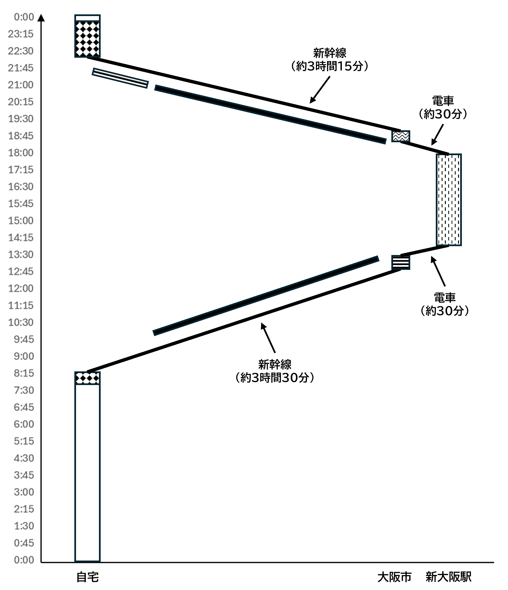

---

## A

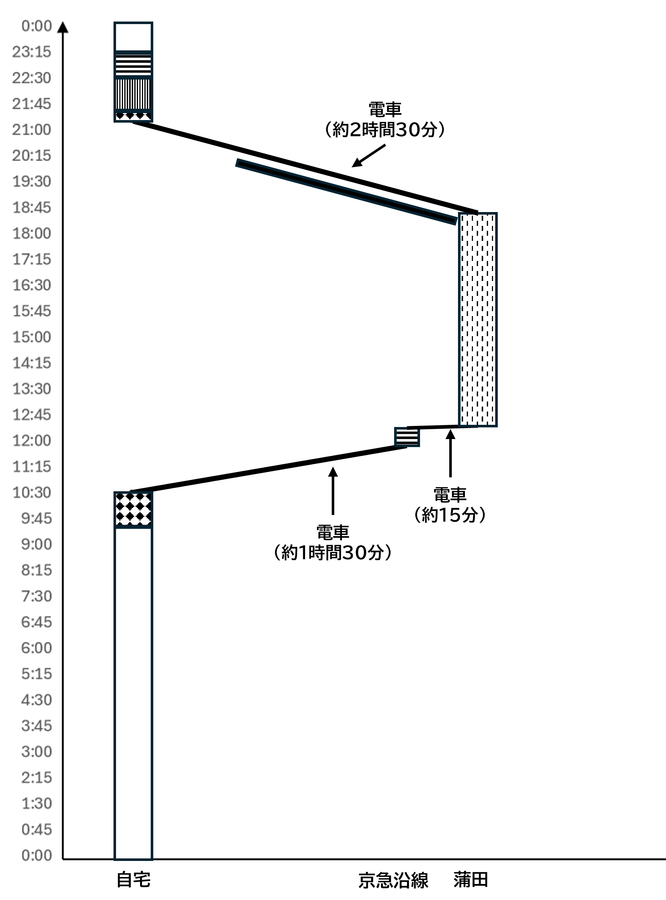

---

## A

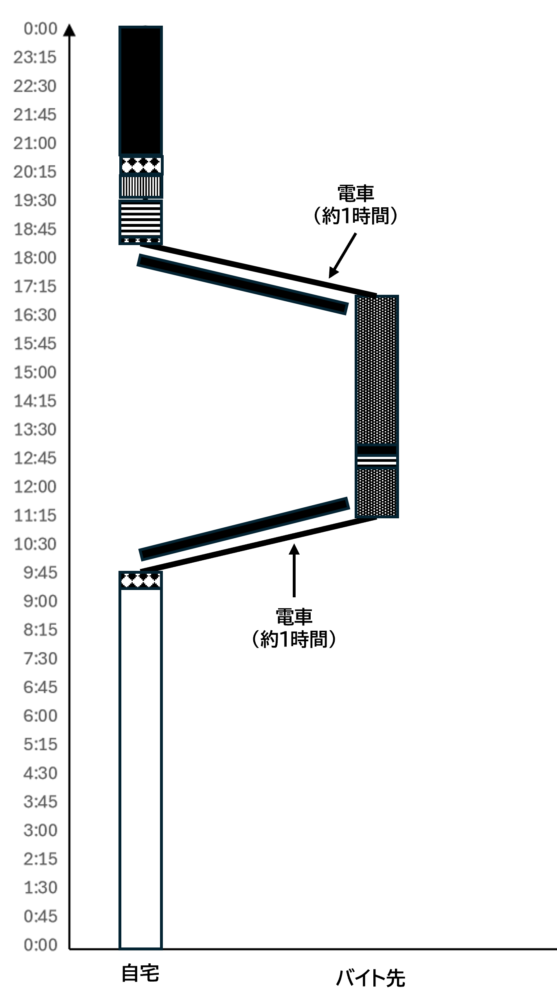

---

## B

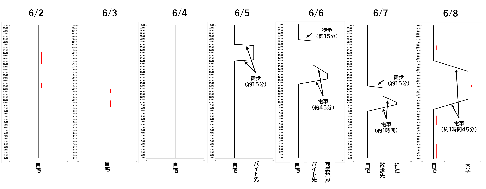

---

## B

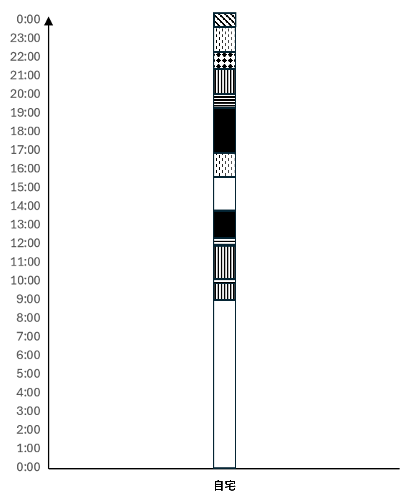

---

## C

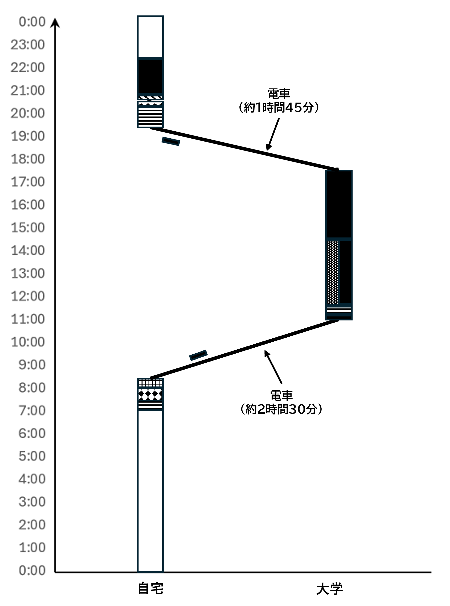

---

## C

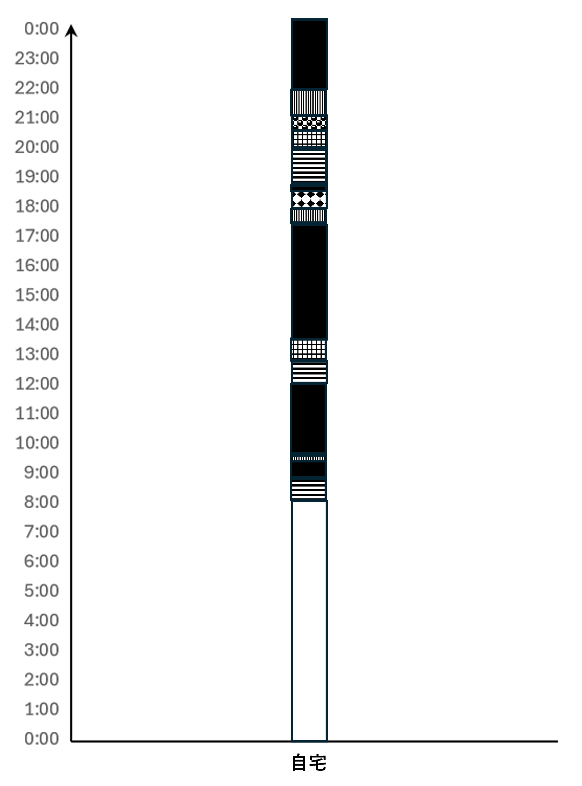

---

## D

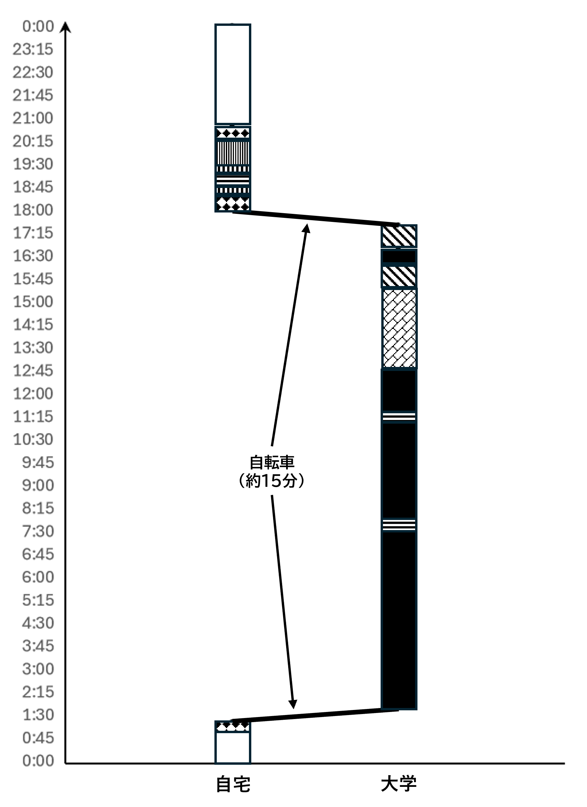

---

## D

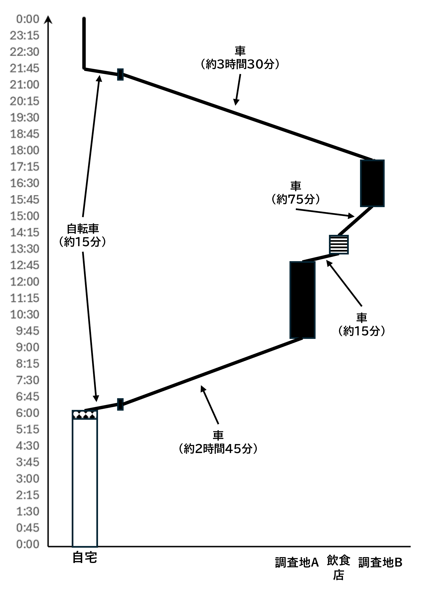

---

## E

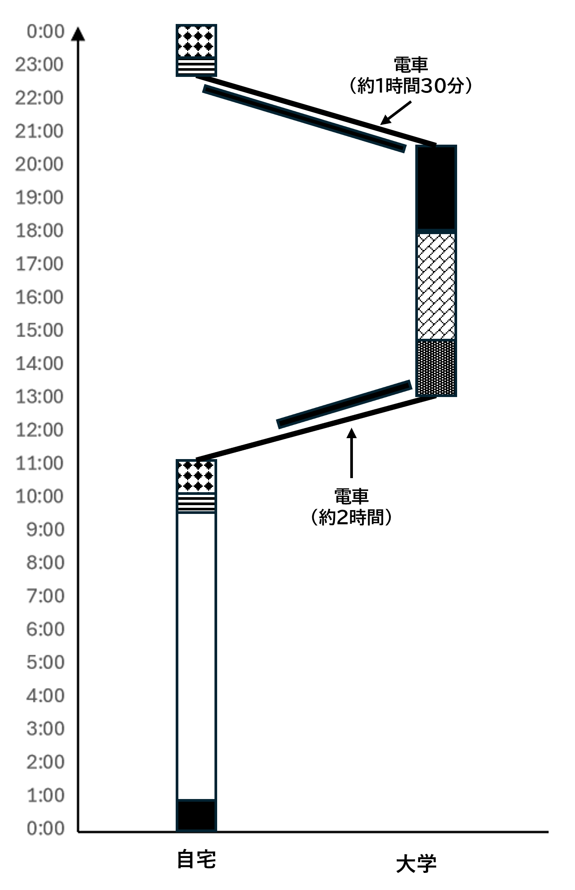

---

## E

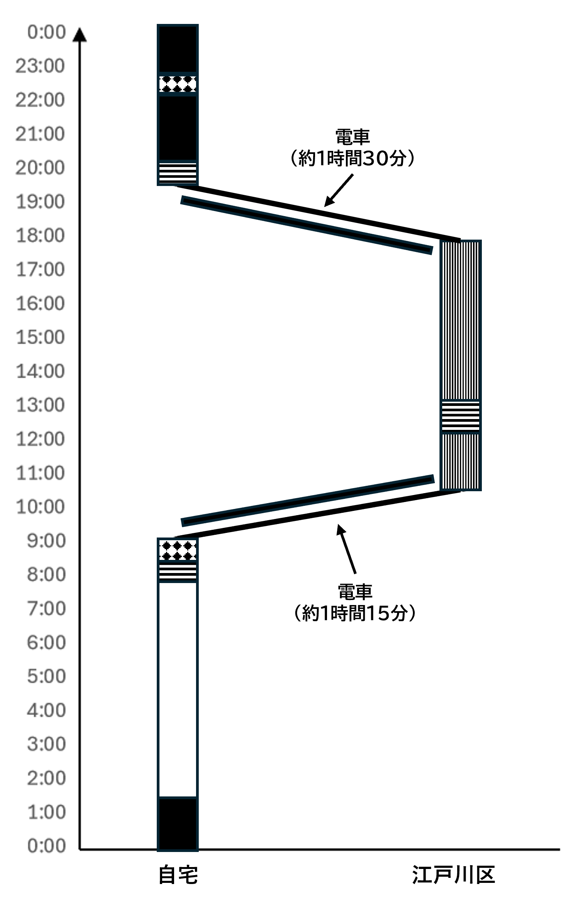

---

## F

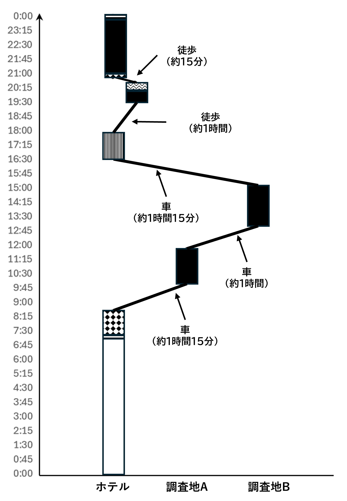

---

## G

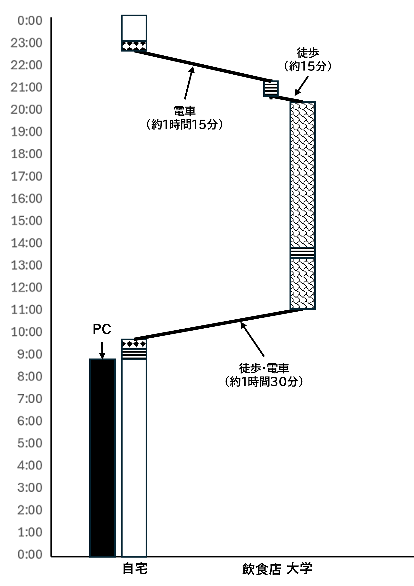

---

## G

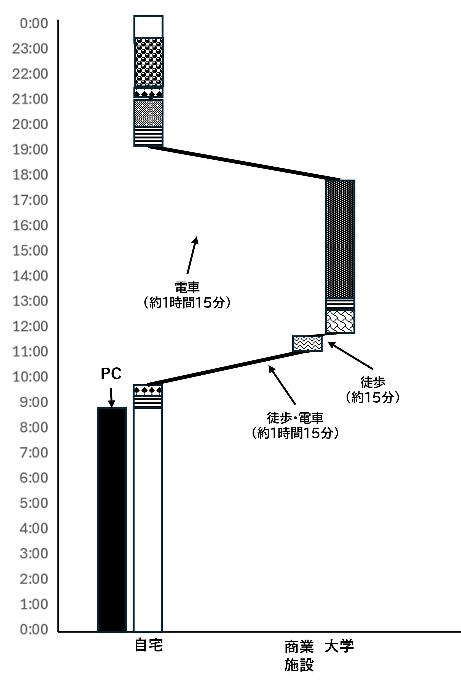

---

## 結合の制約の再検討

- 時間地理学における結合の制約
  - 活動は他者や特定の場所との結合によって制約される
- 本研究の結果
  - 研究者が結合している対象は人間だけではない
  - モノとの結合も知識生産に不可欠

→ 人とモノとの結合に着目する必要がある

---

### ノートパソコンとの結合

## 知識生産を支える中心的なモノ

- 文献の参照
- データの取得
- データ分析
- 発表資料の作成
- 論文執筆

これらの活動の多くが**ノートパソコンを介して実施**

### 事例

- A：新幹線内でデータ分析・発表資料作成
- 他の大学院生も大学・自宅で利用

---

## 結合の制約の再解釈

デジタル技術の発展により

- いつでも
- どこでも

知識生産が可能になったように見える

しかし

> 情報端末との結合がなければ
> 知識生産そのものが困難

つまり

**能力の制約は緩和されたが、
情報端末との結合が新たな前提条件となっている。**

---

## 本研究の含意

人とモノとの結合の存在　**→ラトゥールやANTで既に議論されている**

#### 本研究の着目点

- デジタル機器との結合によって知識生産は研究室やフィールドに限定されない
  - 自宅
  - 宿泊施設
  - 電車
  - 新幹線

など多様な空間で実践されている

→ **地理学的知識の生産は多様な空間・時間に遍在化している**
　この遍在化を理解するにはラトゥールが提唱した不変可動体と計算の中心が有用

次節：**不変可動体と計算の中心の観点からみた時空間構造の解釈**

---

## 不変可動体と計算の中心の観点からみた時空間構造の解釈

- Latour（1987）『**Science in action**』の科学論を援用
  - 日本語：川崎勝・高田紀代志訳　『**科学が作られているとき　人類学的考察**』
  - 科学的知識はいかにして生み出されるのかを理論的に整理した著作
- 着目する概念
  - **刻印**（inscription）
  - **不変可動体**（immutable mobile）
  - **計算の中心**（centre of calculation）

---

### 刻印（inscription）とは何か

- 現象や実態を記録し、参照・比較・操作可能な状態へ変換すること
- 刻印を行う道具（ノートや計測機器など）を**刻印器**（inscription device）と呼ぶ
- 訳語は曖昧
  - ラトゥール（1999）「銘刻」，（2008）「刻印」，（2021）「描出」

### 刻印の例

- 地図
- 統計表
- 写真
- 標本

→ 科学者は対象そのものではなく**刻印を操作することで知識を生産する**

---

### 刻印の性質

ラトゥールによれば刻印は以下の性質が求められる

1. 持ち帰ることができるように「**動かせる**」もの
2. 変形、破壊、腐朽されることなく動かしたりできるように「**安定した**」もの
3. 蓄積され、まとめられ、並び変えられるような「**結合可能な**」もの

→この条件を持つ手段を発明することで科学の**蓄積のサイクル**を維持・向上させる

#### 蓄積のサイクル

- 遠隔地の事象を刻印として持ち帰り、それを基に再び遠隔地へ赴くことで、更なる刻印を持ち帰ることができる

---

### 不変可動体（immutable mobile）

- **内容を保持したまま移動可能な痕跡**
  - 刻印の性質の1と2
- 例
  - 標本
  - 地図
  - 写真

---

## Fの事例：不変可動体の生成

### 植物標本の整理

- 調査後にホテルで標本整理
- 新聞紙で乾燥処理
- 将来の研究資料として保存

### 意味

**植物**　←そのままでは保存・比較できない
↓
**乾燥処理**　←腐らせずに持ち運べる状態にする
↓
**標本**　←不変可動体の性質を持つ刻印

---

### 計算の中心（Centre of Calculation）

- 不変可動体を集積し、比較・分析をして、新たな刻印へ再構成すること
  - 刻印の性質の3

重要なのは、

特定の空間であること　✕

不変可動体を操作できること　〇

→ どのような場所でも計算の中心になりうる

> 地方の小さな町でも、たいしたことない実験室でも、ガレージにある取るにたらない小さな会社でも（ラトゥール 1987: 378）

---

### ノートパソコンという計算の中心

- 大学院生が最も利用していた装置

#### できること

- 文献の参照
- 統計データの取得
- GIS分析
- 図表作成
- 発表資料作成
- 論文執筆

など

→刻印を収集し、比較や分析を一台で実行可能

---

- ノートパソコンという装置は刻印の収集から結合までを一台でこなすことが可能
- 計算の中心を、どこにでも持ち運べ、いつでも中断・再開を可能にする
- 日々の地理学的な知識の生産に、このような装置が中心的に用いられる
  - > 諸要素の可動性、安定性、結合可能性を高めるものは何でも、それが蓄積のサイクルを加速するものであれば、歓迎され、選択される。
  　　　　　　　　　　　　　　　　　　　　　（ラトゥール 2008：385）

次節：**不変可動体による科学実践の時空間的拡散**

---

## 不変可動体による科学実践の時空間的拡散

### 問題意識

- 前節
  - 不変可動体
  - 計算の中心
  - ノートパソコン

を用いて大学院生の実践を解釈

### 地理学的な問い

- 地理学的知識はどこで生産されているのか
- 計算の中心はどこに存在しているのか

---

### 計算の中心は固定された空間なのか

- 特定の建物である必要はない
- 不変可動体を操作できれば成立する
  - → 計算の中心は実践によって形成される

### 持ち運べる計算の中心

- 本研究で確認された中心的装置
- 研究室以外でも知識生産が可能

---

### 知識生産の空間的拡散

- A：新幹線、電車、バイト先
- B：自宅
- C：自身の状況に応じた大学と自宅を使い分け
- D：深夜の研究室
- E：電車内（余暇活動への移動中）
- F：調査地のホテル、自宅　←ノートパソコンではなく標本整理など
- G：自宅と大学

---

### 計算の中心は遍在化し、知識生産は日常生活へ展開

- 研究室などの専門的な空間の意義は失われたのか？
  - 依然として重要
- しかし研究室は唯一の知識生産空間ではなく、複数存在する計算の中心の一つ

---

### 時間的拡散：Gの事例

就寝前

- プログラムの編集

就寝中

- シミュレーションが実行

起床

- シミュレーション結果が生成
- それを基に修正や更なる分析を行う

### ポイント

研究者が休息している間にも、新たな刻印が生成される

---

#### 従来

研究活動＝研究者の活動時間

#### Gの事例

研究活動≠研究者の活動時間

### 知識生産の一部を機械が独立して行う

- 人間
- 計算機

が異なる時間リズムで生産

→時間の拡張？

---

### 結論

刻印の可動性・安定性・結合可能性を支える技術が向上したことによって、知識生産は自宅や移動、宿泊施設などの日常的・社会的空間へと展開している

- いつでもどこでも計算の中心となりうる
- 様々なタイミングで発生する

　　　　　　　　　　↓

実験室や研究室のみを対象とするのではなく、
地理学の**実践がどのような時間と空間に分布しているのか**、その時空間的配置そのものを把握する必要がある

特定の場所や時間に固定されていない？
→個人の社会的・経済的・地理的な状況によって位置づけられる？

---

### 知識の正当性と空間との関係の再検討

- デジタル技術の発達によって、知識生産は特定の場所から切り離されつつある

### 問い

空間の遍在化は**知識の正当性と空間との関係にどのような影響を与えるのか**

---

### 科学の地理学における空間の役割

- 空間は単なる背景ではない
- 知識の信頼性や正当性を支える条件

#### ボイルの実験室

- 初めは私的な実験の空間
- 実験によって生まれた知識の正当性を示すために証人（紳士階級のみ）を呼ぶ
- 私的な実験室から、正当性を示すために紳士階級のみが立ち入る空間へ

→ 正当性と特定の空間が結びついていた

---

### 俗世から離れる

リヴィングストン（2010）

> 社会から身を退くことが、普遍的な価値を持つ知識を保証するための前提条件である（リヴィングストン 2010：29）

例

- 修道院
- 初期の大学（現在も？）

### 特徴

- 世俗世界との距離
- 特殊な知識生産空間
- 客観性・権威の担保

---

### 本研究で確認された実践の空間

- 研究室
- フィールド

だけではない

- 自宅
- 電車
- 新幹線
- 宿泊施設

---

### 発表資料作成

- 分析結果・考察を整理する実践
- 研究コミュニティに対して自身が生産した知識の正当性を示す実践の一つ

→研究室だけではなく自宅や移動中で行われていた

---

### 現代の地理学的知識の生産においての空間の役割

従来

- 研究室
- 実験室
- 大学

などの専門的空間 → 知識の信頼性・正当性と結びついて理解

現在

- 自宅
- 電車
- 宿泊施設

などでも知識生産が遂行 → 空間と正当性の関係を従来と同様には理解できない可能性

---

- 持ち運べる計算の中心によって、様々な空間・時間で地理学の実践が起こる
  - 地理学の実践の空間は遍在化
- 従来の専門化された空間や拡大した日常的・社会的な空間と、知識の正当性との関係を再検討する必要がある

地理学的知識の生産空間の変化は**知識の正当性と空間との関係を再考する課題を提起している**
